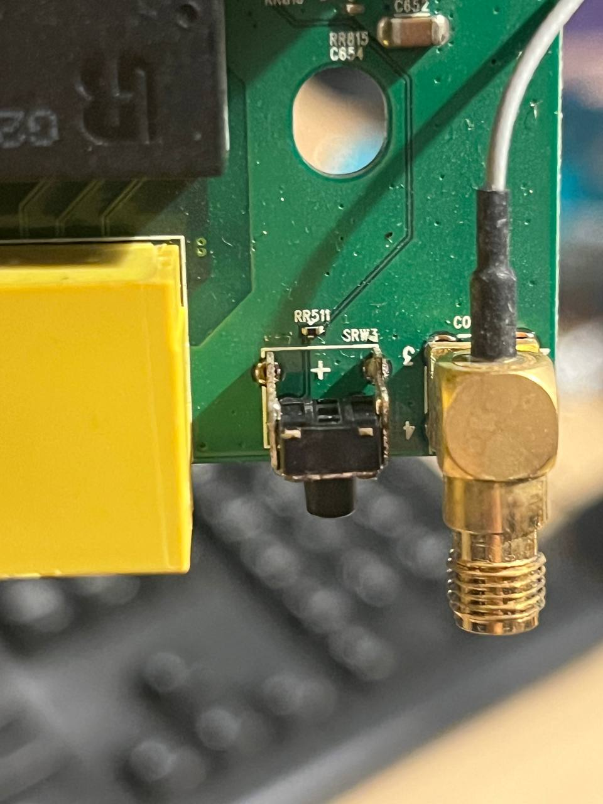
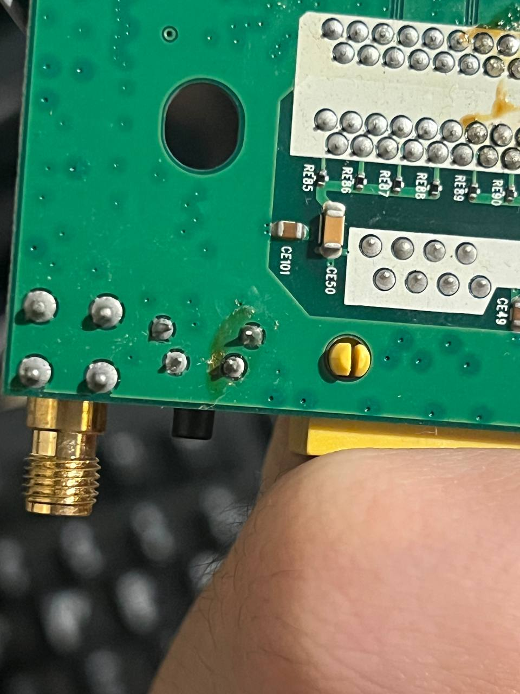

# Hardware

Unit: ASUS DSL-N55U, **original revision** (HW A1 = Annex A, productid `DSL-N55U`). B1 = Annex B (`DSL-N55U-B`).
The later **C1 and D1 revisions are completely different MediaTek platforms** (MT7620A / RT63365) running 1.1.x firmware.
Nothing here applies to them.

Sources: WikiDevi, the ASUS GPL tarball for 3.0.0.4.376_2736, the ASUS U-Boot source inside it, and the live device.

## Summary

| | |
|---|---|
| Main SoC | Ralink **RT3662F** (RT3883 family), MIPS 74Kc (`MIPS 74K V4.12`), 500 MHz. Same SoC as the ASUS RT-N56U |
| DSL SoC | TrendChip **TC3162LE**, with its own 1 MiB SPI flash + 2 MiB RAM. Hangs off switch port 0 |
| RAM | 128 MiB (Linux sees 125844 kB) |
| Flash | 8 MiB **parallel NOR** (MX29LV640EBTI, CFI, 64 KiB erase blocks) at phys 0x1c000000 |
| Switch | Realtek **RTL8367R-VB** (live: `switch IC = CHIP_RTL8367R_VB, SDK = V1.2.6`) |
| 2.4 GHz | RT3092 on PCI (PCI id **1814:3091**, bus 1 dev 0), 2T2R, EEPROM in Factory @0x8000, MAC e0:3f:49:XX:XX:68 (`rai0`) |
| 5 GHz | On-SoC RT3662 radio, 3R, EEPROM in Factory @0x0, MAC e0:3f:49:XX:XX:6c (`ra0`) |
| Ethernet | GMAC1 RGMII to the switch's EXT1, fixed 1000/full. Four LAN ports, no dedicated WAN port |
| USB | 2× USB 2.0 (EHCI 1-1/1-2, OHCI 2-1/2-2) |
| Serial | 4-pin header; Linux console `ttyS1,57600n8`; U-Boot `baudrate=57600` (not yet wired up) |
| JTAG | 14-pin header (per WikiDevi; unverified) |

The DSL-N55U is essentially an RT-N56U with a different switch, no WAN port, and a DSL co-processor. The ASUS build
config is literally the RT-N56U one plus `DSL=y DUALWAN=y` (`src-ra/target.mak:44`), and the bootloader is the RT-N56U
U-Boot (`Uboot.N56U`) with `#if DSL_N55U` blocks.

## Flash map

From `drivers/mtd/maps/ralink-flash.c` (GPL). It matches the live `/proc/mtd`:

| mtd | Offset | Size | Name | Contents |
|---|---|---|---|---|
| 0 | 0x000000 | 0x030000 | Bootloader | Ralink/ASUS U-Boot 1.1.3 (2011-11-01) |
| 1 | 0x030000 | 0x010000 | nvram | ASUS nvram, `key=value\0`, **plaintext** (admin password, WPS PIN, ...) |
| 2 | 0x040000 | 0x010000 | Factory | Radio EEPROMs @0x0 / @0x8000, MAC @0x4 (also @0x28) |
| 3 | 0x050000 | 0x7b0000 | linux | uImage firmware (kernel + squashfs), then the DSL trailer |
| 4 | (inside 3) | 0x6ba500 | rootfs | the squashfs within mtd3 (`root=/dev/mtdblock4`) |

This window is identical to OpenWrt's RT-N56U `firmware` partition (0x50000, 7872 KiB).

Factory dump highlights (`backup/flash/mtd2_Factory.bin`):
```
0x0000: 6236 0000 e03f 49XX XX6c ...   chip id 0x3662, MAC e0:3f:49:XX:XX:6c
0x8000: 9230 0201 e03f 49XX XX68 ...   chip id 0x3092, MAC e0:3f:49:XX:XX:68
```

## GPIOs

Sources: `rc/init.c` (`case MODEL_DSLN55U`), U-Boot `common/gpio.c`, `drivers/char/rtl8367r_drv.c`.

| GPIO | Bank/pin in OpenWrt DT | Function | Polarity |
|---|---|---|---|
| 0 | gpio0 0 | Power LED (also used as the WPS LED by stock) | active low |
| 1 | gpio0 1 | Wi-Fi on/off slide switch (`btn_wifi_gpio`). Reads 0 = "on", 1 = "off" (verified) | active low |
| 2 | gpio0 2 | "LED_INTERNET" in U-Boot | active low (assumed) |
| 3 | gpio0 3 | **Reset button** (differs from the RT-N56U's GPIO13) | active low |
| 22 | gpio0 22 | RTL8367R SMI **SDA** (bit-banged) | |
| 23 | gpio0 23 | RTL8367R SMI **SCK** (bit-banged) | |
| 25 | gpio1 1 | WAN LED | active low |
| 26 | gpio1 2 | WPS button | active low |

### Board observations (case opened 2026-11-02)
- **Reset button = `SRW3`**: a right-angle through-hole tact switch at the board edge between the yellow LAN block and the
  rear antenna SMA connector, with `RR511` next to it. **It is dead on this unit**: no continuity across its two front pins
  when pressed (measured on the switch pins themselves), while the WPS switch's equivalent pins do conduct. The underside
  shows a green/yellow residue around SRW3's pins (corrosion or old flux).
- Workaround: shorting SRW3's two front pins is electrically the same as pressing it (GPIO3 to ground), e.g. with tweezers at
  power-on for rescue mode. See [03-bootloader-and-recovery.md](03-bootloader-and-recovery.md).
- Replacement part: a standard right-angle (side-actuated) 4-pin THT tactile switch with two mounting tabs, like the WPS one.

| Front (SRW3, RR511, rear SMA) | Underside (SRW3 pins with residue, left of the round yellow plug) |
|---|---|
|  |  |

RT3883 pin groups (Linux `pinctrl-rt3883.c`): i2c = GPIO1-2, spi = 3-6, uartf = 7-14, uartlite = 15-16, jtag = 17-21,
mdio = 22-23, lna a/g = 32-38, pci = 40-71, ge1 = 72-83, ge2 = 84-95. Stock programs **GPIOMODE = 0x189f**, i.e.
i2c, spi, uartf and mdio as GPIO; jtag and uartlite keep their functions.

## Switch wiring (RTL8367R-VB)

From ASUS `rtl8367r_drv.c`:

| Switch port | Connected to |
|---|---|
| 0 | TrendChip TC3162LE (DSL modem); stock reaches it via VLAN 1 / `eth2.1` and SVLANs `eth2.1.x` |
| 1-4 | LAN ports. **Front label LAN1 = switch port 4** (verified under OpenWrt); the others presumably reversed (LAN4 = port 1) |
| EXT1 (OpenWrt `cpu_port 5` on R-VB) | RT3662 GMAC1, RGMII, **tx delay 1 / rx delay 2**, forced 1000/full |

Stock VLANs: `eth2.2` = LAN, `eth2.1` → DSL, `eth2.4` = Ethernet-WAN-on-a-LAN-port (dual-WAN option).
Management is GPIO-bit-banged Realtek SMI on GPIO23/22, not the SoC's MDIO controller.

## Bootloader environment (from the mtd0 dump)

```
bootcmd=tftp   bootdelay=1   baudrate=57600   ipaddr=192.168.1.1   serverip=192.168.1.11
```
See [03-bootloader-and-recovery.md](03-bootloader-and-recovery.md) for the boot flow.
